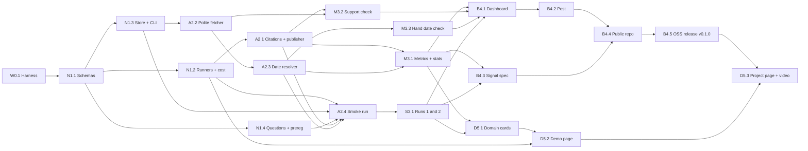

# AI Visibility Tech Spec

Nov 15, 2026 · @Biplob Chakraborty · Companion to the [AI Visibility PRD](AI%20Visibility%20PRD.md)

The PRD says what the study shows and why. The study ships as **`citewatch`**, an open-source tool (MIT, on PyPI) that anyone can run with their own questions, country, models and keys; the UK health study is its flagship run (OWNER D-23, D-24). This spec says how it is built: a loophole review of the PRD, the design decisions it forces, the pipeline, schemas, exact metric definitions, the collection protocol (runners, polite fetcher, date resolver), the support and hand checks, the demo, the cost model, testing, the study runbook, and the build harness that delivers it node by node.

The build method is the one EvalKit used (`~/EvalKit`, Tech Spec §11): a lean adaptation of the Kova node harness. Build nodes form a dependency graph; a node starts only when its dependencies are green and turns green only when its proofs pass every gate twice and a skeptical verifier fails to disprove its criteria. The harness scripts are ported from EvalKit, not rewritten.

---

## 1. Loophole review of the PRD

Every finding below is closed by a section of this spec (Appendix A) and, where the PRD itself is wrong or ambiguous, by an amendment (Appendix B). Severity: **C** critical (the headline number would be wrong or indefensible), **H** high (a reviewer could knock a finding down), **E** engineering (the build would stall or drift).

| ID | Finding | What goes wrong if left open | Closed by |
| --- | --- | --- | --- |
| C1 | **`nhs.uk` and `gov.uk` are public suffixes.** The Public Suffix List lists `nhs.uk`, `gov.uk`, `police.uk` and `ac.uk` (checked 15 Nov 2026). `tldextract` therefore returns `www.nhs.uk` as the registrable domain, not `nhs.uk`, and every NHS trust (`guysandstthomas.nhs.uk`) becomes a separate "domain" | The PRD's own example (`domain: "nhs.uk"`) is impossible as specified; the most-cited UK health publisher would be split across dozens of rows and undercounted | D-4, §4 `publisher` and `publisher_group`, CIT-05 |
| C2 | **Citation share has no unit.** Claude attaches citations sentence by sentence, often citing one URL several times; OpenAI annotates spans. Raw citation counts reward whichever model cites more granularly | Domain shares and the model comparison measure citation style, not sourcing | D-3, §6.1 (answer-level presence share is the headline) |
| C3 | **Date sources are trusted blindly.** HTTP `Last-Modified` on dynamic pages is usually the fetch time; many CMSs stamp `dateModified` with the build time; FR6 also omits meta tags and visible "Page last reviewed" text, which is where NHS pages state their dates | Pages look fresh when they are not; the freshness finding inverts | D-5, §7.3 (all candidates kept, plausibility rules, review date first), DAT-01–03 |
| C4 | **"Stale" is undefined at the answer level.** "Rests on pages not updated in 12 months" could mean any cited page, all of them, or the majority | The stale-answer rate (US3, the market-sizing number) can be moved anywhere by the definition chosen after seeing data | §6.3 (primary and secondary definitions), D-7 (pre-registered) |
| C5 | **The date parser is tuned and reported on the same pages.** NFR3's 20-page test set and the 50-date hand check are not separated by rule | A reported date error rate that is training accuracy (the EvalKit D-5 trap) | D-6, §8.2 held-out rule |
| C6 | **The support check would keep page bodies.** EvalKit's content-addressed store caches judge prompts, and judge prompts contain page sentences | NFR6 and B7 broken by the tool used to check them | D-11, SUP-04, gate 9 storage audit |
| H1 | **"A UK reader" is not enforced.** Without `user_location`, both search tools localise by request IP. The builder is not in the UK | Results reflect the builder's location, not a UK reader's | §7.1 (`user_location` GB on both), ASK-01/02 |
| H2 | **Model overlap is uncalibrated.** Pooled Jaccard per intent rises with sample size, and a model does not even agree with itself between runs | "The models agree 40%" cannot be read without knowing the self-agreement ceiling | §6.4 (per-question Jaccard normalised by run-to-run self-Jaccard), D-12 |
| H3 | **Two runs is not a variance estimate.** n = 2 gives a difference, not an interval; the real sample is the 100 questions | Error bars that don't exist, or that understate uncertainty | §6.6 (question-cluster bootstrap; runs measure stability) |
| H4 | **`urllib.robotparser` uses first-match rules.** RFC 9309 uses longest match. `Allow: /` before `Disallow: /private` is allowed by urllib and disallowed by RFC 9309 and Google | The fetcher could fetch pages a site disallows, breaking NFR1 and B3, the study's most important bar | D-10 (protego), FET-01 |
| H5 | **Cited is not consulted.** Both APIs return the sources searched as well as those cited. A publisher retrieved but never cited is a different, also valuable, signal | The data partnerships persona's question (which sources answers lean on) is half answered | §4 `ConsultedSource`, CIT-01/02, MET-01 |
| H6 | **OpenAI adds tracking parameters to cited links** (`utm_source=openai`); redirects and fragments also split one page into several URLs | The same page fetched several times; URL-level counts inflated | CIT-04 canonicaliser |
| H7 | **The page can change between answer and fetch.** A page modified after the model read it yields a negative lag | Impossible lags, or a fresh date credited to an answer built on the older page | §6.3 (modified-after-answer excluded and counted), SUP-06 |
| H8 | **Over-length answers and refusals have no rule.** Regenerating them is selection bias; dropping them silently hides a difference between models | Biased denominators | §3.4, §6.1 denominators |
| H9 | **Server-side refusal fallbacks would swap models.** The Claude API's recommended `fallbacks` option reroutes a refused request to another model | A "Sonnet 5.5" answer written by a different model | D-8 (no fallbacks; refusals recorded) |
| H10 | **The question set is written after the method, by the person who reports it, with no freeze.** | Questions edited after seeing results; a reviewer can claim the set favours NHS | D-7, QST-01–03 (rubric first, frozen hash before run 1) |
| H11 | **The cost bar is about 40% low.** Search results enter the context as input tokens on both APIs, and each search adds a per-call fee. A planning estimate is about $19 a run, not $12 (§10) | A run aborted halfway, or an unplanned overspend | §10, SMK-02, Appendix B |
| H12 | **Live mode contradicts B6.** US8 says the reviewer "watches both models answer"; B6 says the demo shows sourcing, not answer text | A demo that shows health answers to the public | D-17 (citations and spans only) |
| H13 | **Small-sample cells.** Stale rate per model × intent rests on 8–12 time-sensitive answers per cell | Per-intent percentages that read as precise | §6.6, dashboard shows counts and CIs; per-intent rows marked directional |
| H14 | **The support-check claim is unnamed.** B4 says "the page states the claim" but not which text is the claim | Judges and hand labels judging different things | §8.1 (claim = the answer span the citation is attached to) |
| E1 | **EvalKit's `faithfulness` is not public API.** It lives in `evalkit.scorers.faithfulness` but is not in `evalkit.scorers.__all__`, and EvalKit has no release tag yet | An EvalKit refactor silently breaks the support check | D-11 (pin a commit; contract test on the imported symbols) |
| E2 | **Runs 1 and 2 could run different code.** Nothing stops a runner or extractor fix between runs | Run-to-run variance includes code changes | §13 gate G2 (runner files unchanged between runs) |
| E3 | **Nothing replays offline.** The PRD stores citations, not raw responses | Every extractor fix needs a paid rerun; no golden test is possible | D-2 (raw responses are the source of truth) |
| E4 | **Sitemaps can be huge.** `nhs.uk`-scale sitemap indexes hold tens of thousands of URLs | Unbounded downloads, against the one-request-per-second spirit | DAT-05 (robots-listed sitemaps only, size cap, streamed) |
| E5 | **The PRD ties the build to a dated schedule** (one build day, then a demo day) that about 20 verified nodes do not fit | Verification is cut to hit a date, or the schedule slips silently | OWNER D-16 (no dated schedule; build in dependency order now), D-13 |

---

## 2. Design decisions

Each decision seeds `docs/decisions.md` as D-1 to D-25; D-26 onward are added during the build. `OWNER D-n` marks a ruling the owner made on 15 Nov 2026.

| ID | Decision | Alternatives considered | Why |
| --- | --- | --- | --- |
| D-1 | A linear stage pipeline (`ask → extract → fetch → score → report`) over JSONL, with a content-addressed raw store. No DAG runtime | Import EvalKit's DAG runtime; Prefect or Dagster | Five linear stages over a few thousand records. EvalKit's runtime is not public API. A content-addressed store still gives resume, replay and exact rescoring |
| D-2 | Raw API responses and fetch metadata are the source of truth; every derived table is rebuilt from them offline | Store only parsed citations | Extractor fixes cost nothing; golden replay tests become possible; anyone can audit the parse |
| D-3 | The headline share is **answer-level presence**: the share of answers citing a publisher at least once. A citation-weighted share (each answer's weight split evenly over its unique URLs) is secondary; raw citation counts are shown but never headline | Raw citation counts (PRD) | Removes the citation-granularity bias between models (C2) |
| D-4 | `publisher` is the PSL registrable domain, except for hosts under institutional public suffixes (`nhs.uk`, `gov.uk`, `police.uk`, `ac.uk`, `sch.uk`), where `www.` hosts map to the suffix itself (`www.nhs.uk → nhs.uk`) and other hosts keep their registrable domain with `publisher_group` set to the suffix (`guysandstthomas.nhs.uk`, group `nhs.uk`) | Raw `tldextract` (splits NHS); host names | The PRD's intent (`nhs.uk` as one publisher) without hiding trusts, which are separate organisations (C1) |
| D-5 | Every date candidate on a page is kept with its source; the effective date is chosen by a fixed precedence with plausibility rules (§7.3), review dates first | One date per page from a short chain (PRD FR6) | Wrong dates are the top risk in the PRD; keeping candidates makes the hand check able to measure each source and makes the choice auditable (C3) |
| D-6 | The 20-page test set (NFR3) is the **tuning set**; the 50-date hand check is **held out**. A parser change after the hand check requires 25 freshly labelled pages before publishing | One set for both | A reported error rate must not be training accuracy (C5) |
| D-7 | Pre-registration: metric definitions, thresholds, exclusions and seeds are written in `docs/preregistration.md` and the questions file is frozen, both by sha256 recorded in `decisions.md`, before run 1. Any later change is a logged deviation | Define metrics while analysing | Removes the "definition chosen after seeing data" attack (C4, H10) |
| OWNER D-8 | Both models get the same instruction, `user_location` = London, GB, at most three searches, reasoning effort **medium**, no sampling parameters, and **no server-side fallbacks**. Refusals are recorded, never rerouted | Provider defaults (Sonnet 5.5 defaults to high, Sol to its own default); fallbacks on | Parity between models, and every answer is from the model it claims to be (H1, H9) |
| D-9 | Both models are asked each question concurrently; question order is shuffled per run with a recorded seed | All Claude then all GPT | Search indexes drift by the hour; interleaving keeps the two models seeing the same web |
| D-10 | robots.txt is parsed with `protego` (RFC 9309, longest match); a URL is fetched only when it allows our user agent | `urllib.robotparser` (PRD) | urllib's first-match semantics can allow paths a site disallows (H4) |
| D-11 | The support check calls EvalKit's `faithfulness()` with both judges (Opus 5.5 and GPT Sol), EvalKit pinned to an exact commit, with a contract test on the imported symbols. EvalKit's store and the page text live in a temp folder outside the repo and are deleted after scoring | Write a new judge; single judge; pin a future tag | Reuses a calibrated, blinded judge; dual judges measure self-preference (GPT Sol judging GPT answers); NFR6 holds (C6, E1) |
| D-12 | Uncertainty comes from a question-cluster bootstrap (each question's answers from both models and both runs resample together). Run-to-run comparison measures stability, not variance. Overlap is reported beside each model's self-overlap | Variance from two runs | 100 questions is the sample; two runs cannot give an interval (H2, H3) |
| D-13 | Lean Kova harness ported from EvalKit: one builder plus a fresh-context skeptical verifier, with verifier rounds repeated until a pass confirms every criterion, as in EvalKit (green bar: D-26) | Rounds capped at two; tests only | With no dated schedule (OWNER D-16) nothing justifies cutting verification; quality first |
| D-14 | Build status comes from `scripts/status.py` in the repo | A plan file in the statusnow skill | statusnow is wired to the Kova and VOC repos (EvalKit D-13) |
| D-15 | Dashboard and post are static HTML on Cloudflare Pages; the demo lives in the shared `portfolio-demos` Streamlit app and reads `domain_cards.json` | GitHub Pages (EvalKit's choice) | Free static hosting with a global CDN for the dashboard and post; lookups never call a model |
| OWNER D-16 | No dated schedule: all nodes are built now, in dependency order (§12.3), and the study runs when S3.1 becomes eligible | Offline nodes Mon–Tue, runs Wednesday; everything on one build day (PRD milestones) | The owner's ruling ("strip off dates, we build all now"); dates had been driving scope, not quality |
| D-17 | Live demo mode shows each model's citations (URL, publisher, quoted span), never the answer prose | Show full answers (US8 wording) | B6 wins over US8's wording (H12) |
| D-18 | Python 3.12 only; CI on Linux and macOS (**superseded by OWNER D-23**: Python 3.11–3.13 on Linux, macOS and Windows) | EvalKit's 3.11–3.13 × three OS matrix | Written when this was a study repo, not a tool others install |
| OWNER D-19 | Study budget about $45 (two runs of about $19, smoke about $2, support check about $3), measured by the smoke run first; any single run over $25 still needs the owner's go-ahead | Hold to the PRD's $24 | The measured cost, not a guess, sets the bar; quality over cost |
| OWNER D-20 | The `ai-visibility` git repo is this folder (`AI visibility/`), with the PRD and this spec at its root; public GitHub repo `ai-visibility` | A new `~/ai-visibility` folder | Matches EvalKit, whose PRD and spec live in the repo root |
| OWNER D-21 | The repo is public on GitHub (`biplob819/ai-visibility`) from the first commit and is pushed as nodes turn green | Private until the B4.4 release | The owner's ruling ("we will publish as public repo; push to remote"); CI runs from the first push. B4.4 keeps the full-history audit and the README |
| OWNER D-22 | Job-search framing (the application the study supports, outreach tracking, the posting link, the private hub doc) lives in a gitignored `Portfolio notes.md`; the public PRD uses a neutral product-lead persona for US6 | Publish the PRD as written | Same rule as EvalKit: the public repo stays about the study |
| OWNER D-23 | Open source as a reusable tool plus the flagship study: anyone runs their own study with their own questions file, intents, country, supported models and keys; the UK health study is the flagship run. Python 3.11–3.13 on Linux, macOS and Windows; no telemetry. Adds node B4.5 | An open reproducible study only (no package, UK only) | The owner's ruling ("it should be published as an open source project"); the method is more useful than one dataset |
| OWNER D-24 | Distribution, CLI and import name `citewatch`; the GitHub repo stays `ai-visibility` | `ai-visibility` (taken on PyPI by an unrelated GEO toolkit, checked 15 Nov 2026); `ai-citation-audit` | Short, says what it does, free on PyPI, and avoids confusion with tools for gaming AI answers (B9) |
| D-25 | The politeness floor is not configurable: robots.txt is always honoured, at most 1 request per second per host, at most 2 retries, never after a block, only cited URLs fetched, a user agent naming the tool and a contact is required. Users may only make it stricter | Configurable rate and robots override for power users | An open-source fetcher is run by people we never meet; NFR1 and B3 must hold for every study, not just ours |

---

## 3. Pipeline

### 3.1 Stage contract

```python
class Stage(Protocol):
    name: ClassVar[str]           # "ask", "extract", "fetch", "score", "report"
    code_version: ClassVar[str]   # bump when logic changes; part of every key

    def key(self, unit: BaseModel, cfg: StudyConfig) -> str:
        # sha256 over canonical JSON of name, code_version, unit, cfg.hash, prompt_hash
        ...
```

- **Raw store.** `data/raw/<stage>/<key[:2]>/<key>.json.gz`, written atomically, first writer wins (EvalKit L-18). `ask` stores the provider response verbatim before parsing anything. `fetch` stores status, headers, robots decision and date candidates, never the body.
- **Units.** `ask`: (run, question, model). `fetch`: canonical URL (fetched once across both runs). `extract`, `score` and `report` are pure functions of the store and rebuild in seconds.
- **Run identity.** The run number is in the `ask` key, so run 2 can never be served from run 1's cache.
- **Ledger.** One writer appends `data/runs/<run_id>/run.log` (JSON lines: stage, key, cache hit, latency, cost, error).

### 3.2 Study graph

```
questions.jsonl (frozen) ─▶ Ask[run × question × model]  (interleaved, ≤3 searches, GB location)
                                     │ raw responses
                                     ▼
                        Extract ─▶ citations.jsonl, consulted.jsonl
                     (API fields only, canonical URL, publisher)
                                     │ unique canonical URLs
                                     ▼
              Fetch (robots via protego, 1 req/s/host, 10 s, ≤2 retries)
                                     │ headers + body in memory
                                     ▼
          ResolveDates ─▶ page_meta.jsonl (all candidates, chosen dates, sources)
                                     │
         ┌───────────────────────────┼─────────────────────────────┐
         ▼                           ▼                             ▼
  Metrics (DuckDB views,    SupportCheck (50 citations,      HandDateCheck (50 URLs,
  cluster bootstrap)        EvalKit dual judges, hand        stratified by date source)
         │                  labels; temp store deleted)            │
         └──────────────┬────────────┴─────────────────────────────┘
                        ▼
        summary.json ─▶ dashboard, post charts, domain_cards.json
```

### 3.3 Where each output lives

| File | Contents | In the public repo |
| --- | --- | --- |
| `data/questions.jsonl` | 100 frozen questions | Yes |
| `data/raw/ask/**` | Raw API responses, gzipped | Yes (answers carry quoted spans of at most a sentence; no page bodies) |
| `data/citations.jsonl`, `data/consulted.jsonl` | Parsed, canonicalised | Yes |
| `data/page_meta.jsonl`, `data/fetch_log.jsonl` | Dates, candidates, fetch audit | Yes |
| `data/labels/*.csv` | Hand labels for dates and support | Yes |
| `results/summary.json`, `results/domain_cards.json` | Metrics | Yes |
| `~/.cache/citewatch/bodies/` | Support-sample page text and EvalKit store | Never; deleted after M3.2 |

### 3.4 Error and retry rules

| Error | Retry | Recorded as |
| --- | --- | --- |
| Transport, 429, 5xx, overloaded | Exponential backoff with jitter, up to 6 attempts | `error="transport"` if it still fails; excluded from share denominators, counted per model |
| `stop_reason="refusal"` (Claude) or a refusal output (OpenAI) | Never; no fallback model | `refusal=True`; counted per model; excluded from share denominators |
| `stop_reason="pause_turn"` (Claude server-tool loop) | Continue the turn by resending the response content, up to 3 times | Normal answer; continuation count recorded |
| Server-tool error block (`web_search_tool_result` with an error object, e.g. `max_uses_exceeded`, `too_many_requests`) | Never | Kept as given; `search_errors` recorded |
| Answer over 150 words | Never regenerated | `over_length=True`; included in metrics, rate reported per model |
| Answer with zero citations | Never | Included in denominators (it cites nobody); count reported |
| Fetch: transport, 5xx, 429 | At most 2 retries, honouring `Retry-After` | `fetch_error` with the last status |
| Fetch: 401, 403, 451, robots disallow, login wall | Never (B8) | `blocked` / `gated`; date from non-fetch sources only (`page_age`) or `none` |

---

## 4. Schemas (pydantic)

Results format v1. Every file carries `schema_version: "1.0"`. Models are frozen; sequences are tuples; floats reject NaN and infinity (EvalKit L-8, L-9).

```python
Intent = str     # one of StudyConfig.intents; the flagship study uses
                 # symptoms, treatment, nhs_services, fitness, nutrition
ModelId = str    # a supported web-search model: claude-* (Anthropic) or gpt-* (OpenAI);
                 # the flagship study uses claude-sonnet-5-5 and gpt-6.1-sol


class StudyQuestion(BaseModel):
    id: str                          # "v-017"
    text: str
    intent: Intent
    time_sensitive: bool
    ts_reason: str | None            # which rubric clause makes it time-sensitive (QST-01)


class AnswerRecord(BaseModel):
    run: int                         # 1 or 2; 0 = smoke
    question_id: str
    model: ModelId
    model_snapshot: str              # exact id the provider reports
    raw_key: str                     # raw store key of the verbatim response
    answer_text: str
    word_count: int
    over_length: bool
    searches: int                    # search calls the provider reports
    search_errors: tuple[str, ...]
    refusal: bool
    error: Literal["transport"] | None
    tokens_in: int                   # includes search-result tokens
    tokens_out: int                  # includes reasoning
    cost_usd: float                  # tokens + per-search fees
    answered_at: datetime            # UTC
    prompt_hash: str
    config_hash: str


class Citation(BaseModel):
    run: int
    question_id: str
    model: ModelId
    url_raw: str                     # exactly as the API returned it
    url: str                         # canonical (CIT-04)
    host: str
    publisher: str                   # D-4, e.g. "nhs.uk"
    publisher_group: str | None      # e.g. "nhs.uk" for an NHS trust host
    title: str | None
    quoted_span: str | None          # Claude cited_text; None for OpenAI
    answer_span: str                 # the answer text this citation is attached to (§8.1)
    ordinal: int                     # position among this answer's citations


class ConsultedSource(BaseModel):    # searched or opened, cited or not (H5)
    run: int
    question_id: str
    model: ModelId
    url: str
    publisher: str
    page_age: str | None             # Claude web_search_result.page_age, verbatim
    cited: bool


class DateCandidate(BaseModel):
    kind: Literal["modified", "published", "reviewed", "review_due"]
    value: date
    source: Literal["schema_org", "microdata", "meta_tag", "visible_text",
                    "sitemap", "page_age", "http_header"]
    evidence: str                    # property name or matched text, at most 120 chars
    rejected: str | None             # plausibility rule that rejected it, if any


class PageMeta(BaseModel):
    url: str
    fetched_at: datetime | None
    outcome: Literal["ok", "robots_disallowed", "blocked", "gated", "not_html",
                     "fetch_error", "too_large", "not_fetched"]
    status: int | None
    final_url: str | None            # after redirects
    candidates: tuple[DateCandidate, ...]
    date_modified: date | None
    date_published: date | None
    date_reviewed: date | None
    review_due: date | None
    modified_source: str | None
    published_source: str | None
    reviewed_source: str | None
    effective_date: date | None      # §6.3
    effective_source: str | None


class Interval(BaseModel):
    point: float
    lo: float
    hi: float
    n: int                           # count beside every percentage (FR9)
    k: int | None = None             # numerator where the metric is a share


Kind = Literal["presence", "weighted", "consulted"]


class ShareRow(BaseModel):           # §6.1; intent None = all intents
    publisher: str
    model: ModelId
    intent: Intent | None
    run: int
    kind: Kind
    share: Interval


class ConcentrationRow(BaseModel):
    model: ModelId
    run: int
    top10_share: Interval
    hhi: float


class FreshnessRow(BaseModel):       # §6.3
    publisher: str
    model: ModelId | None
    dated_pages: int
    median_lag_days: float | None
    iqr_days: tuple[float, float] | None
    modified_after_answer: int


class StaleRow(BaseModel):
    model: ModelId
    intent: Intent | None
    definition: Literal["primary", "secondary"]
    rate: Interval
    undated: int


class OverlapRow(BaseModel):         # §6.4; model set only for kind "self"
    intent: Intent | None
    run: int | None
    kind: Literal["cross_model", "self", "normalised", "pooled_top20"]
    model: ModelId | None
    value: Interval


class StabilityRow(BaseModel):       # §6.5
    model: ModelId
    publisher: str | None
    metric: Literal["self_jaccard", "share_change"]
    value: Interval


class AccuracyRow(BaseModel):        # §8.2; source "overall" or a date source
    source: str
    within_7_days: Interval
    exact: Interval


class SupportRow(BaseModel):         # §8.1
    model: ModelId
    judge: str
    support_rate: Interval
    hand_agreement: float | None
    kappa: Interval | None


class CitationsRow(BaseModel):      # citations per answer (§6.1), added by M3.1 (D-55)
    model: str
    intent: str | None
    run: int
    unique_per_answer: Interval
    raw_per_answer: float
    zero_citation: int


class OverdueRow(BaseModel):        # NHS overdue (§6.3), added by M3.1 (D-55)
    model: str | None
    share: Interval


class ComparisonRow(BaseModel):     # paired model comparison (§6.6), added by M3.1 (D-55)
    publisher: str
    run: int
    model_a: str
    model_b: str
    difference: Interval
    p_value: float
    p_holm: float
    separated: bool


class StudySummary(BaseModel):
    schema_version: str
    runs: tuple[int, ...]
    config_hash: str
    questions_sha256: str
    preregistration_sha256: str
    share: list[ShareRow]            # publisher × model × intent × run: presence and weighted
    citations: list[CitationsRow]
    concentration: list[ConcentrationRow]
    freshness: list[FreshnessRow]
    stale: list[StaleRow]
    overlap: list[OverlapRow]
    stability: list[StabilityRow]
    comparisons: list[ComparisonRow]
    nhs_overdue: list[OverdueRow]
    coverage: Interval               # URLs with a resolved date or a logged reason
    date_accuracy: list[AccuracyRow] # overall and per source (M3.3)
    support: list[SupportRow]        # per model, per judge, with hand-label agreement (M3.2)
    check_methods: dict[str, str]    # how each human-in-the-loop check was made (D-67)
    error_counts: dict[str, dict[str, int]]   # model -> {refusal, transport, over_length, zero_citation}
    spend_usd: float
    generated_at: datetime


class DomainCard(BaseModel):         # what the demo shows
    publisher: str
    share_by_model: dict[str, Interval]
    share_by_intent: dict[str, Interval]
    citations: int
    answers_citing: int
    median_freshness_lag_days: int | None
    dated_pages: int
    questions_citing: tuple[str, ...]
    cited_instead: tuple[str, ...]   # §9
    improvement: tuple[Improvement, ...]  # why cited or not, each with a fix (OWNER D-65)


class Improvement(BaseModel):          # one row of a card's improvement report
    code: Literal["intent_absent", "undated", "hidden_date", "stale", "robots_blocked",
                  "robots_unreadable", "blocked", "not_html", "fetch_error", "unsupported"]
    finding: str                     # sourcing, dates and readability only (NFR4)
    fix: str
    count: int                       # 0 < count <= of
    of: int
    sources: tuple[str, ...]         # every study file the count and denominator come from
    examples: tuple[str, ...]        # up to three URLs or intents


class SupportVerdict(BaseModel):
    citation_ref: str                # run:question:model:ordinal
    judge: str
    verdict: Literal["supported", "unsupported"]
    quote: str | None                # at most one sentence; the page text itself is never kept
    hand_label: Literal["supported", "unsupported"] | None


class HandDateLabel(BaseModel):
    url: str
    true_modified: date | None
    true_published: date | None
    not_determinable: bool
    note: str


class StudyConfig(BaseModel):        # loaded from study.yaml (citewatch init writes one)
    name: str                        # "uk-health-2026-11"
    questions_path: str              # JSONL of StudyQuestion
    intents: tuple[str, ...]         # every question's intent must be one of these
    models: tuple[ModelId, ...]
    effort: Literal["low", "medium", "high"]
    user_location: dict[str, str]    # any country; flagship: {"type": "approximate", "country": "GB", "city": "London", ...}
    max_searches: int                # 3
    word_limit: int                  # 150
    stale_days: int                  # 365
    seeds: dict[str, int]            # order, support_sample, hand_sample, bootstrap
    max_cost_usd: float | None
    user_agent: str                  # must name a contact; the politeness floor itself is not configurable (D-25)
```

---

## 5. Interfaces and CLI

```python
class AnswerRunner(Protocol):
    model: ModelId
    async def ask(self, q: StudyQuestion, cfg: StudyConfig) -> RawResponse: ...

class CitationExtractor(Protocol):
    model: ModelId
    version: str
    def extract(self, raw: RawResponse, rec: AnswerRecord) -> tuple[list[Citation], list[ConsultedSource]]: ...

def canonical_url(url: str) -> str: ...
def publisher_of(url_or_domain: str) -> tuple[str, str | None]:  # shared by extractor and demo lookup
    ...
def resolve_dates(meta: FetchResult, page_age: str | None) -> PageMeta: ...
def lookup(domain: str) -> DomainCard | NotCited: ...
async def ask_live(question: str, session_token: str) -> list[LiveCitationCard]: ...
```

| Command | What it does | Needs keys |
| --- | --- | --- |
| `citewatch init [dir]` | Writes `study.yaml`, a questions template and `.env.example` into a new study folder; never overwrites | No |
| `citewatch doctor` | Python version, which keys are set (never printed), network, `prices.yaml` age, user agent contact set | No |
| `citewatch ask --run N [--questions ids] [--dry-run] [--max-cost X]` | Asks the questions on both models; `--dry-run` prints call counts and the cost estimate and exits | Yes, except `--dry-run` |
| `citewatch extract` | Rebuilds citations and consulted sources from the raw store | No |
| `citewatch fetch [--dry-run]` | Fetches new canonical URLs politely, resolves dates; `--dry-run` lists hosts, URL counts and the minimum wall-clock at 1 req/s | No |
| `citewatch score [--sample-support] [--labels path] [--finalise]` | Metrics; draws or scores the support and hand-check samples; `--finalise` deletes the body cache and asserts it is empty | Judges only for the support check |
| `citewatch report [--example]` | Dashboard, post charts, `domain_cards.json`; `--example` renders the bundled golden fixture | No |

Every command takes `--json`. Exit codes follow EvalKit: 0 done, 2 configuration or runtime error, 3 stopped at the cost cap (resumable), 4 judging pending.

---

## 6. Metric definitions

Defined here once, copied verbatim into `docs/preregistration.md`, and frozen before run 1 (D-7). Notation: an **answer** is a (run, question, model) record; a **valid answer** has no transport error and no refusal. P(a) is the set of publishers among answer a's unique canonical URLs.

### 6.1 Share (US1, FR7)

- **Presence share (headline).** For publisher p and a slice S of valid answers (model × intent × run): share(p) = |{a ∈ S : p ∈ P(a)}| / |S|. Zero-citation answers stay in the denominator.
- **Weighted share (secondary).** Each valid answer with citations gives weight 1 / |URLs(a)| to each unique URL's publisher; share(p) = Σ weights / |S with citations|. Sums to 1 over publishers.
- **Consulted share.** Presence share computed on consulted sources instead of citations; shown beside the cited share so "retrieved but not cited" is visible.
- **Citations per answer.** Unique canonical URLs per valid answer (headline); raw citation-block count shown alongside.
- **Concentration.** Top-10 weighted share and the Herfindahl–Hirschman index of weighted share, per model.

### 6.2 Effective date

`effective_date` = the chosen `date_reviewed` if present, else `date_modified`, else `date_published` (§7.3 decides each). Pages without one are **undated**, with the outcome as the logged reason.

### 6.3 Freshness and stale answers (US2, US3)

- **Lag.** lag(url, a) = `answered_at.date − effective_date`, in days. A page whose effective date is after `answered_at` was modified after the model read it: excluded from lag and counted as `modified_after_answer` (H7).
- **Publisher freshness.** Median and interquartile range of lag across that publisher's dated cited URLs, with the count of dated pages.
- **Stale answer, primary.** A valid, time-sensitive answer with at least one dated citation is stale when its **newest** dated citation is older than 365 days: the answer has no fresh source at all.
- **Stale answer, secondary.** At least one dated citation older than 365 days.
- **Undated answers.** Time-sensitive answers with no dated citation are reported as their own count and excluded from both rates.
- **NHS overdue.** Share of cited pages whose `review_due` is before `answered_at`. Reported as a supporting figure.

### 6.4 Overlap (US4)

- **Cross-model overlap.** For each question and run, J(q) = Jaccard(P(Claude), P(GPT)), averaged over questions in an intent. Questions where both answers cite nothing are excluded and counted.
- **Self-overlap ceiling.** For each model, the same Jaccard between run 1 and run 2 answers to the same question.
- **Normalised overlap.** Cross-model overlap ÷ the mean of the two self-overlaps. Near 1 means the models disagree with each other about as much as each disagrees with itself.
- Pooled Jaccard of each model's top-20 publishers per intent is shown for readers who expect it, labelled as pooled.

### 6.5 Stability (US5)

Per model: mean per-question Jaccard between runs (the self-overlap above), and for each top-10 publisher the change in presence share between runs, with a paired bootstrap interval.

### 6.6 Statistics

- **Intervals.** Percentile 95% intervals from a question-cluster bootstrap: 10,000 resamples of the 100 questions, each carrying all its answers (both models, both runs). One seeded resample matrix serves every metric (EvalKit D-37).
- **Model comparisons.** Paired bootstrap of the difference over shared questions; a gap is "separated" only if its p-value survives Holm correction across the top-10 publishers compared. Otherwise it is reported as no clear difference.
- **Small proportions.** The 50-item hand checks use Wilson intervals.
- **Cells under 10 answers** show counts and intervals and are marked directional on the dashboard (H13).
- Float totals use `math.fsum` (EvalKit L-27).

---

## 7. Collection protocol

### 7.1 Answer runners

Shared instruction (one string, hashed into `prompt_hash`):

> Answer for a reader in the UK in under 150 words. Use web search to find current sources and cite them.

The question is the user turn. No system persona, no domain hints.

**Claude Sonnet 5.5** (`claude-sonnet-5-5`, Messages API):

- Tool `{"type": "web_search_20260209", "name": "web_search", "max_uses": 3, "allowed_callers": ["direct"], "user_location": {"type": "approximate", "country": "GB", "city": "London", "region": "England", "timezone": "Europe/London"}}`. `allowed_callers: ["direct"]` turns off dynamic filtering: with it on, the first real calls showed the model reading results through code execution and returning answers with **no citations** (D-34). `code_execution` is not declared.
- `output_config: {"effort": cfg.effort}`; thinking left at its default (adaptive); no `temperature`, `top_p` or `top_k` (non-default values are rejected on Sonnet 5.5); no `fallbacks` (D-8).
- `stop_reason` handled: `end_turn`; `pause_turn` (continue); `refusal` (record `stop_details.category`); `max_tokens` (record, keep the answer).
- Citations: `text` blocks carry `citations` of type `web_search_result_location` with `url`, `title`, `cited_text`. Consulted sources: `web_search_tool_result` blocks whose `content` is a list of `web_search_result` (`url`, `title`, `page_age`). An error result's `content` is an object, not a list.
- Searches billed: `usage.server_tool_use.web_search_requests`.

**GPT-6.1 Sol** (`gpt-6.1-sol`, Responses API):

- Tool `{"type": "web_search", "user_location": {"type": "approximate", "country": "GB", "city": "London", "region": "England", "timezone": "Europe/London"}}`, `max_tool_calls: 3`, `include: ["web_search_call.action.sources"]`, `reasoning: {"effort": cfg.effort}`, the shared instruction as `instructions`.
- Citations: `url_citation` annotations on `output_text` (`url`, `title`, `start_index`, `end_index`); the answer span is the text between the indices. Consulted: the sources on `web_search_call` items. Every action type on `web_search_call` (search, open page, find in page) is recorded.

Appendix C lists the provider facts to confirm against live docs at N1.2 before any money is spent.

### 7.2 Polite fetcher

| Rule | Implementation |
| --- | --- |
| Only cited URLs | Input is the canonical URL set from `citations.jsonl`; consulted-only URLs are never fetched |
| robots.txt | `protego`, fetched once per host and cached for the study. 404 or 410 means allow; 401 or 403 means disallow (stricter than RFC 9309, chosen on purpose); 5xx or timeout means disallow. Every redirect hop to a new host is checked against that host's robots |
| Rate | Token bucket of 1 request per second per host, covering robots and sitemap requests too; at most 8 hosts in flight |
| User agent | `citewatch/<version> (+<project page URL>; <study contact address>)`, set in `study.yaml`; `doctor` refuses an unset contact |
| Timeouts and retries | 10 s; at most 2 retries on transport, 5xx and 429 with `Retry-After` honoured; never after 401, 403, 451 or a robots refusal |
| Bodies | `text/html` only, 5 MB cap, held in memory for date resolution and dropped. Support-sample URLs only: main text written to `~/.cache/citewatch/bodies/` for M3.2 and hand labelling, deleted by `score --finalise` |
| Gated pages | A login form or paywall marker on a 200 response is `gated`; no workaround (B8) |
| Audit | `fetch_log.jsonl`: url, host, at (the request's **start** time, UTC), attempt, status, bytes, robots decision, outcome, user agent. Gate 8 replays it and fails on any host above 1 req/s, any fetched disallowed URL, any retry after a block, more than three requests for one page, or a changed user agent. A robots.txt that returned 401, 403 or 5xx makes every later page on that host `robots_disallowed`; A2.2's polite tests pin this, since the audit trusts each line's robots field |

### 7.3 Date resolution

**Candidates** (all kept, DAT-01):

1. JSON-LD (via `extruct`), walking `@graph` and nested objects: `dateModified`, `datePublished`, and `lastReviewed` on `MedicalWebPage`.
2. Microdata and RDFa (via `extruct`): the same properties.
3. Meta tags: `article:modified_time`, `article:published_time`, `og:updated_time`, `DC.date.modified`, `DC.date.issued`, `last-modified`.
4. Visible text: "Page last reviewed: <date>", "Next review due: <date>" (NHS pattern), "Last updated <date>", "Updated on <date>", parsed day-first (UK).
5. Sitemap `lastmod` for the exact canonical URL, only from sitemaps listed in robots.txt (DAT-05).
6. Claude's `page_age` for that URL from any consulted search result (no fetch needed; covers blocked pages). Real responses give it **relative to the request** ("198 days ago"), not as a date, so the resolver converts it with the answer's `answered_at` (D-35).
7. HTTP `Last-Modified`.

**Plausibility rules** (a rejected candidate stays in the list with the rule named):

- Before 1995-01-01, or more than one day after `fetched_at`: rejected.
- HTTP `Last-Modified` within 24 hours of `fetched_at`: rejected (dynamic page).
- `dateModified` or meta modified within 24 hours of `fetched_at`, with no other source within 7 days of it: rejected as a likely CMS stamp.
- A modified date before the published date: the modified candidate is rejected.

**Precedence** for the chosen value of each kind: `visible_text` reviewed > `schema_org`/`microdata` (`lastReviewed`) for *reviewed*; `schema_org` > `microdata` > `meta_tag` > `visible_text` > `sitemap` > `page_age` > `http_header` for *modified* and *published*. The precedence is tuned only on the 20-page test set (D-6) and frozen before the hand check.

---

## 8. Support check and hand checks

### 8.1 Support check (FR8, US5, B4)

1. **Sample.** After run 1's extract and before its fetch (so the fetcher knows which pages' text to keep), draw 50 citations with a recorded seed, stratified by model (25 each) and intent (5 per model × intent), plus 2 reserves per stratum. A sampled citation whose page does not fetch `ok` is replaced by the next reserve in its stratum, and the replacement is logged.
2. **Claim and evidence.** The claim is the `answer_span` the citation is attached to. The evidence is the page's main text (boilerplate stripped), split into sentences.
3. **Judging.** One `FaithfulnessItem` per citation (`question` = the study question, `explanation` = the claim, `evidence` = page sentences) through `evalkit.scorers.faithfulness.faithfulness`, both judges, live mode. EvalKit's executor store points at the body cache folder.
4. **Hand labels.** The owner labels all 50 in a sheet that hides the model, the judge verdicts and the stratum order (EvalKit L-26), using the same rubric: supported only when the page states the claim; a title is not evidence.
5. **Report.** Support rate per model with Wilson intervals, per judge; judge–hand agreement and Cohen's kappa with bootstrap intervals; the answer-to-fetch time gap per item (SUP-06).
6. **Clean-up.** `score --finalise` deletes the body cache and EvalKit store, then asserts both are gone. Only `SupportVerdict` rows (verdict, at most one quoted sentence) are kept.

### 8.2 Hand date check (NFR3, US5)

1. **Sample.** 50 dated URLs drawn with a recorded seed, stratified by `effective_source` in proportion to its frequency with at least 5 per source that has 5 or more pages, plus 5 undated pages to check "no date" is right.
2. **Labelling.** A checker opens each page and records the true modified and published dates, or "not determinable", without seeing the parser's answer. For the flagship study the checker was a fresh-context agent and the owner approved its labels (OWNER D-63, D-64), so results say "agent-checked, owner-approved". Pages the checker could not load are counted and never scored (D-68).
3. **Correct** means the effective date is within 7 days of the hand date; exact-match rate is reported too.
4. **Report.** Error rate overall and per source with Wilson intervals. A source with an error rate above 30% is demoted in the precedence only through a logged deviation, which then requires 25 freshly labelled pages before publishing (D-6).

---

## 9. Demo architecture

- **Lookup (US7).** `lookup(domain)` normalises the input (strips scheme, `www.`, path, port) and maps it through the same `publisher_of` the extractor uses (a contract test asserts they are one function). It reads `domain_cards.json` only; it never calls a model. Target under 1 second.
- **Not in the data.** A publisher that was never cited returns "not cited in any of the N answers in this study", plus the most-cited publishers for the intent the reviewer picks.
- **`cited_instead`.** For a cited publisher: on the questions where it was cited by one model or run but not another, the publishers cited in the answers that left it out, ranked by count.
- **Live mode (US8).** Behind passkey sign-in (WebAuthn; OWNER D-58 replaces the passcode), through the `portfolio-demos` spend guard EvalKit built in D3.1 (persistent daily counter, per-session limit, per-request cap). One question, both models, the §7.1 settings. The screen shows each model's citations (URL, publisher, quoted span) and never the answer prose (D-17). Daily cap $3; at about $0.20 per live question, about 15 questions a day. **Bring your own keys (OWNER D-58):** a signed-in visitor may paste their own Anthropic and OpenAI keys instead of using the owner's; a passkey is still required, the keys live only in that session's memory (never logged, stored or sent anywhere but the provider), and the per-request cap still applies, while the owner's daily cap counts only calls made on the owner's keys.
- **Privacy.** Logs hold timestamp, mode, latency and cost only. No question text, no IP address.

---

## 10. Cost model

Printed before every paid command; the command aborts if the estimate exceeds `max_cost_usd`.

```
answer_claude = t_in × p_in + (t_out + t_think) × p_out + searches × fee_search_claude
answer_gpt    = t_in × p_in + (t_out + t_reason) × p_out + tool_calls × fee_search_openai
run           = Σ_questions (answer_claude + answer_gpt)
support       = Σ_judges 50 × (t_ev × p_in_judge + t_v × p_out_judge)   # live, no batch discount
```

**Planning estimate** (replaced by measured averages after the smoke run, SMK-02). Prices are from EvalKit's `prices.yaml` (checked 14 Nov); search fees assume $10 per 1,000 searches on both providers until Appendix C confirms them.

| Quantity | Estimate |
| --- | --- |
| `t_in`, including up to 3 searches' results | 25,000 |
| `t_out` + reasoning | 1,500 |
| Searches per answer | 3 |
| Claude per answer: 25k × $2/M + 1.5k × $10/M + 3 × $0.01 | ≈ $0.095 |
| GPT Sol per answer (same prices, same fee assumption) | ≈ $0.095 |
| **One run (200 answers)** | **≈ $19** |
| Smoke run (20 answers) | ≈ $2 |
| Support check (50 claims × 2 judges, ~8k evidence tokens) | ≈ $3 |
| **Study total** | **≈ $45** (PRD NFR2: about $24) |

Live demo spend is capped separately at $3 a day. Under OWNER D-19, a single run estimated above $25 waits for the owner's go-ahead, and every paid call is appended, as it is paid, to the study's own spend ledger `<study>/data/spend-ledger.jsonl` (D-33, D-37).

---

## 11. Testing and observability

| Layer | What | Gate |
| --- | --- | --- |
| Unit | Extractors on both formats, canonicaliser, `publisher_of`, robots decisions, rate limiter, every date rule, each metric | `uv run pytest` |
| Property | `canonical_url` is idempotent; `publisher_of` is stable; bootstrap intervals contain the point; weighted shares sum to 1 | `pytest` with hypothesis |
| Contract | Every schema round-trips; recorded Claude and OpenAI responses parse; EvalKit's imported symbols exist with the expected signatures; extractor and demo share `publisher_of` | `pytest -m contract` |
| Data | Once frozen, `questions.jsonl` and `preregistration.md` match their recorded hashes; every JSONL file validates | `pytest -m data` |
| Golden replay | The 10-question smoke responses plus recorded HTTP responses rebuild `summary.json` exactly, with no network | `pytest -m golden` |
| Politeness | A disallowing robots.txt is honoured (including the longest-match case urllib gets wrong); 1 req/s per host under concurrency; no retry after 403; redirect to a new host re-checks robots; user agent constant; fetch-log audit | `pytest -m polite` |
| Safety | Secret scan; storage audit (no HTML or body text in the repo or committed data; body cache empty after finalise); no answer prose in demo templates; B9 checklist present for the post | `pytest -m safety` plus the scanner |
| Static | Lint, types | `uv run ruff check`, `uv run pyright` |
| Compatibility | Python 3.11, 3.12 and 3.13 on Linux, macOS and Windows; golden replay also on 3.11 | CI matrix, gate 7 |
| No-key CLI | `report --example`, `ask --dry-run` and `fetch --dry-run` succeed with no keys; `doctor` exits 2 and names each missing variable without printing any value | `pytest -m onboarding` |

**Observability.** `run.log` per run (§3.1); `summary.json` carries spend and coverage; the dashboard shows error counts per model.

---

## 12. Build harness (lean Kova, as in EvalKit)

The study is built as a graph of build nodes. A node may start only when everything it depends on is green; it turns green only when its proofs pass every gate twice in a row and the verifier fails to disprove its criteria. Scripts are ported from `~/EvalKit/scripts` (`harness_lib.py`, `verify_graph_eligibility.py`, `node_start.py`, `node_converge.py`, `status.py`, `secret_scan.py`) with the gate list changed as in §12.6.

### 12.1 Repo layout for the harness

```
docs/graph/graph.md              # node tables: id, title, depends_on, verified_by, deliverable, stories
docs/graph/catalog.tsv           # cap_id, node, status, proof, note
specs/<node>-<slug>/spec.md      # goal, outputs, rules, out of scope
specs/<node>-<slug>/criteria.md  # one acceptance criterion per capability row
specs/<node>-<slug>/tasks.md     # the seven-step checklist (§12.5)
specs/<node>-<slug>/RUN-STATE.md # now, history (each verifier pass and what it disproved)
docs/preregistration.md          # §6 verbatim, frozen before run 1
docs/decisions.md                # D-n, append-only; OWNER D-n for owner rulings
docs/lessons.md                  # L-n, seeded with the inherited lessons in §12.8
docs/measurements/               # smoke and spend records
changelog.md                     # [TYPE] [NODE] — summary
scripts/{harness_lib,verify_graph_eligibility,node_start,node_converge,status,secret_scan,storage_audit}.py
```

Status vocabulary: `not-started | spec | building | green`.

### 12.2 Build graph: 21 nodes in six waves

**First public release, v0.1.0 on PyPI (all Must stories, US1–US6): 18 nodes**, W0.1 through B4.5. **Full scope: 21 nodes**, adding D5.1–D5.3.

| Node | Title | Depends on | Deliverable (what exists when it is green) | Stories |
| --- | --- | --- | --- | --- |
| **W0.1** | Repo and harness | — | uv project, CI, ported harness scripts with `--self-test`, records seeded, verifier template | — |
| **N1.1** | Schemas and config | W0.1 | §4 schemas, `study.yaml` loader, results format v1 fixtures | US1–US5 |
| **N1.2** | Answer runners and cost model | N1.1 | Claude and OpenAI runners (§7.1), `prices.yaml`, pre-run estimate, spend ledger, recorded response fixtures | US1 |
| **N1.3** | Store, ledger and CLI skeleton | N1.1 | Raw store, `run.log`, Typer CLI with `--dry-run`, `--max-cost`, `--json`, exit codes, `doctor` | US1 |
| **N1.4** | Questions, pre-registration, data card | N1.1 | Rubric, 100 frozen questions, `preregistration.md`, `DATA_CARD.md` | US1, US3, US5 |
| **A2.1** | Citation extraction and publisher mapping | N1.2 | Both extractors, consulted sources, `canonical_url`, `publisher_of` | US1, US4 |
| **A2.2** | Polite fetcher | N1.3 | §7.2 in full, fetch log | US2 |
| **A2.3** | Date resolver | A2.2 | §7.3 candidates, rules and precedence; 20-page test set passing | US2, US5 |
| **A2.4** | Smoke run | N1.2, N1.3, N1.4, A2.1, A2.3 | 10 questions × 2 models for real; measured cost model; golden fixture; parity report | US1, US5 |
| **M3.1** | Metrics and statistics | A2.1, A2.3 | §6 in DuckDB plus bootstrap, `summary.json` writer | US1–US5 |
| **M3.2** | Support check | A2.1, A2.2 | §8.1 sampling, EvalKit judging, labelling sheet, agreement, clean-up | US5 |
| **M3.3** | Hand date check | A2.3 | §8.2 sampling, sheet, error rates | US5 |
| **S3.1** | Study runs 1 and 2 | A2.4 | Both runs collected, extracted, fetched, audited, reconciled and frozen (§13) | US1–US5 |
| **B4.1** | Findings dashboard and deploy | M3.1, M3.2, M3.3, S3.1 | Static dashboard on Cloudflare Pages | US1–US5 |
| **B4.2** | The post and charts | B4.1 | Post with charts generated from `summary.json` | US6 |
| **B4.3** | Signal spec | M3.1, S3.1 | One-page PDF: fields, buyers, delivery, pricing logic | US6 |
| **B4.4** | Public repo | B4.2, B4.3 | README, licence, data card, decisions, history audit, repo public | US5, US6 |
| **B4.5** | Open-source packaging and v0.1.0 | B4.4 | PyPI `citewatch`, `init`, run-your-own-study and responsible-use docs, community files, release workflow, import contract test, tag v0.1.0 | US5, US7 |
| **D5.1** | Domain cards and lookup | M3.1, S3.1 | `domain_cards.json`, `lookup()` | US7 |
| **D5.2** | Demo page and live mode | D5.1, N1.2 | Streamlit page in `portfolio-demos`, guarded live mode | US7, US8 |
| **D5.3** | Project page, video, supporting notes | B4.5, D5.2 | Case study page, 90-second video, how-I-built-it note, one-page PRD | US6 |

Waves: **W0** harness → **N1** core → **A2** collection pipeline → **M3/S3** measurement and the real runs → **B4** write-up and release → **D5** demo and portfolio.

### 12.3 Node map, levels and build order



| Level | Nodes |
| --- | --- |
| 0 | W0.1 |
| 1 | N1.1 |
| 2 | N1.2, N1.3, N1.4 |
| 3 | A2.1, A2.2 |
| 4 | A2.3, M3.2 |
| 5 | A2.4, M3.1, M3.3 |
| 6 | S3.1 |
| 7 | B4.1, B4.3, D5.1 |
| 8 | B4.2, D5.2 |
| 9 | B4.4 |
| 10 | B4.5 |
| 11 | D5.3 |

**Critical path (11 nodes to v0.1.0):** W0.1 → N1.1 → N1.3 → A2.2 → A2.3 → A2.4 → S3.1 → B4.1 → B4.2 → B4.4 → B4.5.

**Build order for a single builder** (OWNER D-16: no dates). The public release first, then the demo. Every node appears after all its dependencies; owner work is listed where it blocks.

| # | Node | Owner work it needs |
| --- | --- | --- |
| 1 | W0.1 | — |
| 2 | N1.1 | — |
| 3 | N1.3 | User-agent contact address |
| 4 | N1.2 | About $1 of live calls for recorded fixtures |
| 5 | N1.4 | Write the rubric and the 100 questions; approve the freeze |
| 6 | A2.1 | — |
| 7 | A2.2 | — |
| 8 | A2.3 | Label the 20-page test set |
| 9 | M3.1 | — |
| 10 | M3.2 | — |
| 11 | M3.3 | — |
| 12 | A2.4 | Go/no-go on the measured cost (about $2 smoke run) |
| 13 | S3.1 | — (about $38 for two runs) |
| 14 | B4.1 | Hand-label 50 dates and 50 citations (they feed the dashboard) |
| 15 | B4.3 | — |
| 16 | B4.2 | Review the post (B9 checklist) |
| 17 | B4.4 | Review the README and the history audit |
| 18 | B4.5 | Reserve `citewatch` on PyPI (placeholder 0.0.1) and set up trusted publishing → **v0.1.0 on PyPI** |
| 19 | D5.1 | — |
| 20 | D5.2 | Passcode and secrets in `portfolio-demos` |
| 21 | D5.3 | Record the video |

N1.3 comes before N1.2 so the raw store exists before the first paid call.

### 12.4 Capability catalog

Each row becomes one line in `docs/graph/catalog.tsv` with status `not-started`. A node is green when all its rows are green. The trace column links each capability to the PRD (FR, NFR, B, US) or to this spec.

**W0.1 Repo and harness**

| Cap | Capability | Trace |
| --- | --- | --- |
| HAR-01 | uv project, `citewatch` package (src layout, Python ≥3.11), MIT licence, ruff pre-commit, `.gitattributes` forcing LF | D-18 |
| HAR-02 | CI on Python 3.11–3.13 × Linux, macOS and Windows: lint, types, tests, golden replay, build on every push; least-privilege workflow permissions | §11 |
| HAR-03 | Ported `verify_graph_eligibility.py` and `node_start.py` with self-tests (cycles, dependencies green, spec and criteria present, check-only writes nothing) | D-13 |
| HAR-04 | Ported `node_converge.py` with the 12 gates of §12.6, every gate reported, each with a self-test that names the planted defect | D-13 |
| HAR-05 | Records: `graph.md`, `catalog.tsv`, `decisions.md` seeded with D-1 to D-25, `lessons.md` seeded per §12.8, `changelog.md`, `scripts/status.py` | D-14 |
| HAR-06 | Secret scan and storage audit gates | NFR6, B7 |
| HAR-07 | Verifier prompt template: skeptical, fresh context, criteria + code + gate output only, private `UV_PROJECT_ENVIRONMENT` | §12.7 |

**N1.1 Schemas and config**

| Cap | Capability | Trace |
| --- | --- | --- |
| SCH-01 | `StudyQuestion`, `AnswerRecord`, `Citation`, `ConsultedSource` | FR1–FR4 |
| SCH-02 | `DateCandidate`, `PageMeta` with outcome enum | FR5, FR6 |
| SCH-03 | `Interval` and the summary rows; `StudySummary` with hashes and error counts | FR7, FR9 |
| SCH-04 | `DomainCard`, `SupportVerdict`, `HandDateLabel` | FR8, FR11 |
| SCH-05 | `StudyConfig` loader with clear validation errors; results format v1 fixtures and round-trip contract tests against an independent list of spec schemas (EvalKit L-10) | §4 |

**N1.2 Answer runners and cost model**

| Cap | Capability | Trace |
| --- | --- | --- |
| ASK-01 | Claude runner: `web_search_20260209`, `max_uses` 3, GB location, effort, `pause_turn` continuation, refusal recorded, no fallbacks, no sampling params | FR2, B1, D-8 |
| ASK-02 | OpenAI runner: Responses API `web_search`, `max_tool_calls` 3, GB location, sources included, reasoning effort | FR2, B1, D-8 |
| ASK-03 | One shared instruction and `prompt_hash`; identical inputs for both models | B1 |
| ASK-04 | Raw response stored verbatim before parsing; keyed by run, question, model, prompt and config hash; resume reruns only missing keys | D-2 |
| ASK-05 | Error and retry rules of §3.4; server-tool errors recorded, never raised | §3.4 |
| ASK-06 | Cost per answer including search-result tokens and per-search fees; `prices.yaml` with `checked_on`; pre-run estimate that aborts over budget; money values checked finite and non-negative (EvalKit L-12); spend ledger | NFR2 |
| ASK-07 | Interleaved scheduling and seeded per-run question order; per-provider concurrency and rate limits | D-9 |
| ASK-08 | Appendix C facts confirmed against live docs and recorded in `decisions.md`; fixtures built from SDK models, not hand-flattened dicts (EvalKit L-17) | Appendix C |

**N1.3 Store, ledger and CLI skeleton**

| Cap | Capability | Trace |
| --- | --- | --- |
| STO-01 | Content-addressed raw store, atomic, first writer wins | D-1, D-2 |
| STO-02 | Single-writer `run.log` | §3.1 |
| STO-03 | Typer CLI with the §5 commands, `--dry-run`, `--max-cost`, `--json`, exit codes 0/2/3/4 | §5 |
| STO-04 | `.env` loading; a missing key error names the exact variable; `doctor` never prints keys and refuses an unset user-agent contact | NFR1 |

**N1.4 Questions, pre-registration, data card**

| Cap | Capability | Trace |
| --- | --- | --- |
| QST-01 | Question rubric written first: natural UK phrasing, no publisher or brand names, one need per question, and the time-sensitive rule (the right answer could change within 12 months: services, eligibility, waiting times, prices, current guidance) | H10, FR1 |
| QST-02 | `questions.jsonl`: 100 questions, 20 per intent, at least 8 time-sensitive per intent, each with `ts_reason`; a lint test enforces the rubric's mechanical rules | FR1 |
| QST-03 | `preregistration.md` (§6 verbatim, seeds, exclusions); hashes of it and the questions recorded in `decisions.md`; data-freeze test | D-7 |
| QST-04 | `DATA_CARD.md`: what is collected, what is discarded, politeness, quoted-span policy, and limits, written in the present tense only for what is already true (EvalKit L-16) | NFR4, NFR6 |

**A2.1 Citation extraction and publisher mapping**

| Cap | Capability | Trace |
| --- | --- | --- |
| CIT-01 | Claude extractor: `web_search_result_location` citations with `cited_text` and answer span; consulted sources with `page_age` | FR3, H5 |
| CIT-02 | OpenAI extractor: `url_citation` annotations with answer span from indices; consulted sources from `web_search_call` | FR3, H5 |
| CIT-03 | Citations come only from API citation fields; a test plants links typed in the answer text and expects none extracted | B2 |
| CIT-04 | `canonical_url`: lowercase host, drop fragment and default port, strip `utm_*` and known click IDs, keep `url_raw`; idempotence property test | H6 |
| CIT-05 | `publisher_of` per D-4 with fixtures for `www.nhs.uk`, an NHS trust, `www.gov.uk`, `bbc.co.uk`, a `.ac.uk` university and a plain `.com` | C1, FR4 |
| CIT-06 | Per-answer unique URL set; raw citation count kept | C2 |

**A2.2 Polite fetcher**

| Cap | Capability | Trace |
| --- | --- | --- |
| FET-01 | robots via `protego` per §7.2, including redirect hops; a test with the longest-match case | B3, NFR1, D-10 |
| FET-02 | 1 req/s per host under concurrency, covering robots and sitemap requests | FR5 |
| FET-03 | User agent naming the study, project page and contact; constant for the study | NFR1 |
| FET-04 | 10 s timeout; at most 2 retries on transport, 5xx, 429 with `Retry-After`; none after a block | FR5, B8 |
| FET-05 | Fetches only canonical URLs from `citations.jsonl`, each once across runs | B3 |
| FET-06 | HTML only, 5 MB cap, bodies memory-only except support-sample text to the body cache | NFR6 |
| FET-07 | Gated-page detection recorded as `gated`, no workaround | B8 |
| FET-08 | `fetch_log.jsonl` and the audit used by gate 8 | NFR1 |

**A2.3 Date resolver**

| Cap | Capability | Trace |
| --- | --- | --- |
| DAT-01 | Candidate extraction from the seven sources of §7.3 | FR6, C3 |
| DAT-02 | Plausibility rules, each rejection named | C3 |
| DAT-03 | Precedence and chosen `date_source` per kind; all candidates kept | FR6, D-5 |
| DAT-04 | 20-page test set (owner-labelled HTML snapshots stored as test fixtures, trimmed to the date-bearing parts) passing | NFR3, D-6 |
| DAT-05 | Sitemaps: only those listed in robots.txt, 10 MB cap, streamed, cached per host | E4 |
| DAT-06 | `review_due` captured for NHS overdue reporting | §6.3 |

**A2.4 Smoke run**

| Cap | Capability | Trace |
| --- | --- | --- |
| SMK-01 | 10 questions (2 per intent) × 2 models answered for real, run 0; spend in the ledger | NFR2 |
| SMK-02 | Measured token, search and cost averages written into the cost model; full-run estimate reprinted; owner go/no-go if above $25 per run | H11 |
| SMK-03 | Extract, fetch and dates run on the smoke data; surprises logged as lessons (EvalKit L-37: the first real run is where design errors surface) | — |
| SMK-04 | Parity report: GB location used, searches ≤ 3, word counts, refusals, citation counts per model | B1, D-8 |
| SMK-05 | Golden fixture: the smoke responses plus recorded HTTP responses, and the `summary.json` they produce | §11 |

**M3.1 Metrics and statistics**

| Cap | Capability | Trace |
| --- | --- | --- |
| MET-01 | Presence, weighted and consulted shares per publisher × model × intent × run | US1, D-3 |
| MET-02 | Citations per answer, top-10 concentration, HHI | FR7 |
| MET-03 | Publisher freshness lag with modified-after-answer exclusions counted | US2, H7 |
| MET-04 | Stale-answer rate (primary and secondary), undated count, NHS overdue share | US3, C4 |
| MET-05 | Cross-model overlap, self-overlap ceiling, normalised overlap | US4, H2 |
| MET-06 | Run-to-run stability | US5 |
| MET-07 | Question-cluster bootstrap, paired differences with Holm, Wilson for hand checks | H3, D-12 |
| MET-08 | `summary.json` writer and DuckDB views; coverage metric with 90% target | FR9 |

**M3.2 Support check**

| Cap | Capability | Trace |
| --- | --- | --- |
| SUP-01 | Seeded stratified 50-citation sample with the replacement rule | FR8 |
| SUP-02 | Claim = answer span; evidence = main text split into sentences | H14, B4 |
| SUP-03 | EvalKit `faithfulness()` with both judges at a pinned commit; contract test on imported symbols | D-11, E1 |
| SUP-04 | Body cache and EvalKit store outside the repo; `--finalise` deletes and verifies; only verdicts and one-sentence quotes kept | NFR6, C6 |
| SUP-05 | Blind labelling sheet; support rate per model and judge; agreement and kappa with intervals | US5 |
| SUP-06 | Answer-to-fetch gap recorded per sampled item | H7 |

**M3.3 Hand date check**

| Cap | Capability | Trace |
| --- | --- | --- |
| HND-01 | Seeded 50-URL sample stratified by date source, plus 5 undated pages | NFR3 |
| HND-02 | Labelling sheet that hides the parser's answer | US5 |
| HND-03 | Error rate overall and per source with Wilson intervals; the held-out rule enforced by a test (parser `code_version` change after labelling blocks publishing until 25 fresh labels exist) | D-6, C5 |

**S3.1 Study runs 1 and 2**

| Cap | Capability | Trace |
| --- | --- | --- |
| RUN-01 | Run 1 ask, extract, fetch; gate G1 and post-run audits of §13 pass | US1–US3 |
| RUN-02 | Run 2 under unchanged runner and extractor code (gate G2); new URLs fetched only | US5, E2 |
| RUN-03 | Spend reconciled with provider usage; any gap above 10% explained | NFR2 |
| RUN-04 | Run manifest (config hash, git SHA, model snapshots, start and end times); data committed and frozen | D-2 |

**B4.1 Findings dashboard and deploy**

| Cap | Capability | Trace |
| --- | --- | --- |
| DSH-01 | Static self-contained HTML: share, freshness lag, overlap by intent; a count beside every percentage; intervals | FR9 |
| DSH-02 | Page-one scope statement (sourcing, not medical accuracy; 100 questions is directional); coverage, error rates and hand-check results panel | NFR4, B6 |
| DSH-03 | Deployed to Cloudflare Pages | D-15 |
| DSH-04 | Every summary field render-tested; accessible without colour alone (EvalKit L-28) | §11 |

**B4.2 The post and charts**

| Cap | Capability | Trace |
| --- | --- | --- |
| PST-01 | Opens with the main finding and the scope statement; links the signal spec | US6, NFR4 |
| PST-02 | Charts generated from `summary.json`; a test checks every number in the post appears in `summary.json` | FR9 |
| PST-03 | B9 review checklist completed and committed | B9 |

**B4.3 Signal spec**

| Cap | Capability | Trace |
| --- | --- | --- |
| SIG-01 | One page: fields (from `PageMeta` and the measured gaps), buyers (publishers, AI labs), delivery, pricing logic as unit of value and tiers without price points | FR10 |
| SIG-02 | PDF renders to exactly one page; every quoted finding traced to `summary.json` | US6 |

**B4.4 Public repo**

| Cap | Capability | Trace |
| --- | --- | --- |
| REL-01 | README: finding, method, how to rerun, cost; licence; data card | US5 |
| REL-02 | Full-history audit (the repo has been public since the first push, OWNER D-21): no keys, no `.env`, no page bodies, no hand-label notes that quote pages at length, no job-search content (OWNER D-22) | NFR6 |
| REL-03 | Decisions, pre-registration and deviations published | D-7 |

**B4.5 Open-source packaging and v0.1.0**

| Cap | Capability | Trace |
| --- | --- | --- |
| OSS-01 | Distribution `citewatch` on PyPI, released by GitHub Actions trusted publishing on a tag; name reserved early with a 0.0.1 placeholder | D-24 |
| OSS-02 | `uvx citewatch --version` and `citewatch report --example` smoke-tested against the published package on all three OS | D-23 |
| OSS-03 | `citewatch init` scaffolds a study folder without overwriting anything; a study with custom intents, another country and one provider runs end to end on recorded fixtures | D-23 |
| OSS-04 | Docs: quickstart (an example report in under 5 minutes with no keys), run your own study (questions format, intents, country, models, cost), how dates are resolved and their limits, controlling cost | D-23 |
| OSS-05 | Responsible use: the politeness floor cannot be lowered by config, flag or environment (tests try each); docs say the tool measures sourcing and is not for gaming AI answers; no telemetry; privacy statement | D-25, B3, B9 |
| OSS-06 | CONTRIBUTING, SECURITY, CODE_OF_CONDUCT, issue and PR templates | D-23 |
| OSS-07 | Semver policy; public API (`citewatch.schemas`, `canonical_url`, `publisher_of`, `lookup`) and an import contract test against the built wheel | D-23 |
| OSS-08 | Tag v0.1.0 with the flagship UK study's results and changelog | D-23 |
| OSS-09 | Release README: screenshots of the dashboard, demo and CLI; a step-by-step guide; every important link in one place, each checked to resolve | OWNER D-58 |
| THR-01 | Thresholds in `study.yaml` (metric, scope, operator, bound; checked against the interval or the point, as declared); `citewatch score` exits 1 and names each failed rule; no rules means exit 0 | OWNER D-65 |
| THR-02 | Example GitHub Actions workflow that runs `citewatch score` on committed data and fails the job on a threshold; docs page on thresholds | OWNER D-65 |

**D5.1 Domain cards and lookup**

| Cap | Capability | Trace |
| --- | --- | --- |
| CRD-01 | `domain_cards.json` from `summary.json` | FR11 |
| CRD-02 | `lookup()` with input normalisation through `publisher_of`; not-cited message; under 1 second | US7, NFR5 |
| CRD-03 | `cited_instead` per §9 | US7 |
| IMP-01 | Per-publisher improvement report in each domain card: why it is or isn't cited (share and rank by intent, freshness and stale rate, missing or unreadable dates by source, robots blocks and fetch errors, judge-unsupported citations) | OWNER D-65 |
| IMP-02 | Each reason maps to a concrete fix with the evidence count behind it; never a medical-accuracy claim; every number traced to `summary.json`, `page_meta.jsonl` or `fetch_log.jsonl` | OWNER D-65, NFR4 |

**D5.2 Demo page and live mode**

| Cap | Capability | Trace |
| --- | --- | --- |
| DEM-01 | Streamlit page in `portfolio-demos`: lookup by default, top-ten picker | US7 |
| DEM-02 | Live mode behind passkey sign-in (WebAuthn) through the shared spend guard; citations only (D-17) | US8, B5, B6, OWNER D-58 |
| DEM-03 | Aggregate-only logging; secrets in the host's secret store | §9 |
| DEM-04 | Deployed | FR11 |
| DEM-05 | Bring your own API keys: a passkey is still required; keys held only in session memory, never logged or stored; per-request cap applies | OWNER D-58 |

**D5.3 Project page, video, supporting notes**

| Cap | Capability | Trace |
| --- | --- | --- |
| PRJ-01 | Case study in the shared template, linking dashboard, post, spec, repo and demo | Deliverables |
| PRJ-02 | 90-second video | Deliverables |
| PRJ-03 | How-I-built-it note and one-page PRD | Deliverables |

D5.3 and the prose parts of B4.2 and B4.3 have no code to test. Their proof cells name a checklist file and the verifier's review instead of a test, and gates 4–7 report `n/a` with a reason, never a silent pass.

### 12.5 Node lifecycle

| Step | What happens | Script or artifact |
| --- | --- | --- |
| 0. Spec | Write `spec.md` and `criteria.md`; grep `decisions.md` first; batch any owner questions into one sitting, recommended option first | `specs/<node>/` |
| 1. Start | Eligibility (dependencies green, no cycles), spec and criteria present for every catalog row | `scripts/node_start.py <node>`; exit 1 means don't start |
| 2. Tests first | Failing tests for each criterion across the five proof dimensions | `tests/` |
| 3. Build | Implement until tests pass | code |
| 4. Converge twice | Full gate set twice in a row with clean caches | `scripts/node_converge.py <node>` |
| 5. Skeptical verify | A fresh-context verifier tries to disprove each criterion and mutation-tests the node's checks; findings are fixed or ruled on; repeated until a pass confirms every criterion with no high or medium finding open (D-13, D-26) | verifier report in `RUN-STATE.md` |
| 6. Flip green | Proof cells in `catalog.tsv`, changelog line, lessons, one local commit for the node | `catalog.tsv`, `changelog.md`, `lessons.md` |

**The five proof dimensions:**

| Dimension | Proof |
| --- | --- |
| Logical | Unit tests for the node's behaviour |
| Contract | Schema, provider-format, CLI or imported-API contract tests |
| Golden replay | The recorded smoke run still rebuilds `summary.json` exactly |
| Reproducibility | Rebuilding derived tables from the raw store is exact; keys are stable; seeds recorded |
| Politeness and safety | robots and rate rules hold, no bodies stored, no secrets, cost within budget |

**Proof cell format:** `logical=<test file>›"<test>"; contract=…; golden=…; repro=…; safety=…` (an `n/a` needs a reason; `logical` can never be `n/a`, EvalKit L-2).

### 12.6 Gates in `node_converge.py`

Every gate runs and is reported even after an earlier one fails. Every gate ships a `--self-test` that proves it can fail and names the planted defect in its output (EvalKit L-1, L-4). A tool error inside a gate is a failure, never "nothing to check" (EvalKit L-3).

1. Node claims work: at least one catalog row for the node is `building` or `green`.
2. Graph eligibility.
3. Proof claims resolve to real, unskipped `def test_*` functions (parsed with `ast`).
4. `uv run ruff check`.
5. `uv run pyright`.
6. `uv run pytest` (unit, property, contract, data).
7. `pytest -m golden` on this interpreter and again on the minimum Python, 3.11 (from A2.4 onward; earlier nodes report SKIP).
8. **Politeness:** `pytest -m polite` plus the fetch-log audit over every committed `fetch_log*.jsonl` (replaces EvalKit's judge-regression gate).
9. **Safety and storage:** `pytest -m safety`, the secret scan, and the storage audit (no HTML or page text in tracked files; body cache empty unless M3.2 is `building`).
10. `uv build`, install into a clean venv, and with no provider credentials in the environment run the smoke commands, each with its expected exit code. The list grows with the nodes: `--version`, `--help`, `init` (exit 0) and `doctor` (exit 2, naming each missing variable, EvalKit L-40) from N1.3; `ask --run 1 --dry-run` (exit 0) from N1.2; `report --example` (exit 0) from B4.1.
11. Changed code has changed tests, measured from the node's base commit.
12. Records: a `changelog.md` entry for the node, `criteria.md` names every catalog row, and `RUN-STATE.md` exists.

### 12.7 Roles

- **Builder** (Claude Code main session): writes specs, tests and code; runs paid commands only within the approved budget; never pushes without the owner's approval.
- **Verifier** (fresh-context subagent, told to be skeptical): tries to disprove each criterion. It sees only the criteria, the code and the gate output, never the builder's reasoning. It runs with its own `UV_PROJECT_ENVIRONMENT` so it cannot rebuild the shared venv mid-converge (EvalKit L-15). For S3.1 it also audits the fetch log and the run manifest.
- **Owner:** writes the questions, labels the 20-page set, the 50 dates and the 50 citations, and rules on scope, budget and trade-offs through batched questions. Rulings are recorded as `OWNER D-n`.

**Dropped from Kova and EvalKit:** lanes, integrator, EM agent, the judge-regression gate.

### 12.8 Lessons inherited from EvalKit

Seeded into `docs/lessons.md` as L-1 to L-12, each citing its EvalKit origin:

| L | Lesson | EvalKit |
| --- | --- | --- |
| L-1 | A gate that has never failed is a gate nobody has checked | L-1 |
| L-2 | Proofs resolve through `ast` to a real, unskipped test | L-2 |
| L-3 | A tool error inside a gate is a failure | L-3 |
| L-4 | Self-tests must name the planted defect, not just exit non-zero | L-4 |
| L-5 | Force LF and name `encoding="utf-8"` on every text read and write | L-7, L-32 |
| L-6 | Every scripted edit asserts its match count before writing | L-11 |
| L-7 | Every money value is checked finite and non-negative before it reaches a cap | L-12 |
| L-8 | Verifiers use a private venv | L-15 |
| L-9 | Docs describe only what is true now and name the node that makes the rest true | L-16 |
| L-10 | Test fakes are built from the SDK's own models | L-17 |
| L-11 | The first real run is where design errors surface; run a small real slice early | L-37 |
| L-12 | A release check must exercise the thing it checks, not grep for it | L-40 |

---

## 13. Study runbook

Each run is an operation inside node S3.1, gated like a node.

**Gate G1, before run 1** (all must hold; `citewatch ask --run 1` refuses otherwise):

1. `questions.jsonl` and `preregistration.md` hashes match `decisions.md`.
2. A2.4 is green and its measured estimate is within the approved budget.
3. `doctor` passes: both keys set, user-agent contact set, `prices.yaml` checked within 7 days.
4. Working tree clean; the git SHA is recorded in the run manifest.

**Run 1:** `ask --run 1` → `extract` → `score --sample-support` (draws the support sample) → `fetch` → audits.

**Audits after each run:** errors below 5% per model (refusals reported, not counted as errors); parity report; fetch-log audit passes; coverage reported; spend appended to the ledger.

**Gate G2, before run 2:** no change since run 1 to runner, extractor, prompt or `study.yaml` files (diffed by path against run 1's SHA); at least 2 hours after run 1 finished, so the runs are not near-duplicates.

**Run 2:** `ask --run 2` → `extract` → `fetch` (new URLs only) → audits.

**Freeze:** run manifest written, data committed, `score` and `report` run, support and hand labels imported, `score --finalise`.

---

## 14. Technical risks

| Risk | Mitigation |
| --- | --- |
| A provider changes a citation format or tool version mid-study | Raw responses kept; extractors versioned; model snapshot on every record; both runs on one day |
| Search results are mostly from a few publishers, so per-publisher intervals for the rest are wide | Counts and intervals shown; findings framed on the top publishers and on aggregate freshness |
| Many sites block the fetcher (bot management) | Logged as `blocked`; `page_age` gives a date without fetching; coverage reported with reasons |
| CMS date stamps fool the plausibility rules | Hand check per source; the held-out rule stops quiet re-tuning |
| The support-check pages differ from what the model read | Answer-to-fetch gap recorded; sample drawn from run 1 and fetched the same day |
| EvalKit changes underneath | Pinned commit plus contract test |
| Cost overruns | Smoke-run measurement, pre-run estimate, `--max-cost`, owner go-ahead above $25 |
| Someone uses the open-source fetcher to scrape or the tool to game AI answers | Politeness floor not configurable (D-25); only cited URLs fetched; responsible-use docs; no gaming advice anywhere (B9) |
| A user's run spends more than expected | `--dry-run` estimate always shown; `--max-cost` hard stop; `doctor` warns on a stale `prices.yaml` |
| The harness costs more time than it saves | Scripts ported from EvalKit, not rewritten; 12 gates, no lanes; add process only when a lesson demands it |

---

## Appendix A: Loophole traceability

| Finding | Closed by |
| --- | --- |
| C1 Public-suffix publishers | D-4, §4 `publisher`/`publisher_group`, CIT-05 |
| C2 Citation granularity | D-3, §6.1, CIT-06, MET-01 |
| C3 Untrustworthy date sources | D-5, §7.3, DAT-01–03 |
| C4 Stale undefined | §6.3, D-7, MET-04 |
| C5 Parser tuned on reported set | D-6, §8.2, HND-03 |
| C6 Support check stores bodies | D-11, §8.1 step 6, SUP-04, gate 9 |
| H1 UK location | §7.1, ASK-01/02 |
| H2 Overlap ceiling | §6.4, MET-05 |
| H3 Two runs as variance | D-12, §6.6, MET-07 |
| H4 robots first-match | D-10, §7.2, FET-01 |
| H5 Cited vs consulted | §4 `ConsultedSource`, §6.1, CIT-01/02 |
| H6 Tracking parameters | CIT-04 |
| H7 Page changed after answer | §6.3, SUP-06 |
| H8 Over-length and refusals | §3.4, §6.1 |
| H9 Fallback model swap | D-8, ASK-01 |
| H10 Question freeze | D-7, QST-01–03, §13 G1 |
| H11 Cost bar | §10, SMK-02, Appendix B |
| H12 Live mode vs B6 | D-17, DEM-02 |
| H13 Small cells | §6.6, DSH-01 |
| H14 Claim undefined | §8.1, SUP-02 |
| E1 EvalKit API | D-11, SUP-03 |
| E2 Code drift between runs | §13 G2, RUN-02 |
| E3 No offline replay | D-2, ASK-04, SMK-05 |
| E4 Sitemap size | DAT-05 |
| E5 Dated schedule | OWNER D-16, D-13 |

## Appendix B: PRD amendments (pending the owner's OK)

| PRD item | Amendment |
| --- | --- |
| Data model, `Citation.domain` example | Replace `domain` with `publisher` and `publisher_group` (D-4) |
| US1, FR7 | "Share" means answer-level presence share; weighted share secondary (D-3) |
| US3 | Add the primary and secondary stale definitions of §6.3 |
| FR5 | `protego` instead of `urllib.robotparser` (D-10) |
| FR6, `PageMeta` | Seven candidate sources with plausibility rules; add `lastReviewed`, visible review dates and `page_age` |
| NFR2 | About $19 per run, about $45 for the study, measured after the smoke run (OWNER D-19) |
| NFR3 | 20-page set is the tuning set; 50-date hand check is held out |
| US8, flow B step 3 | Live mode shows citations, not answers (D-17) |
| Milestones, deliverable "Ready by" column, build-day line in the overview | **Applied 15 Nov 2026** (OWNER D-16): dates removed; build order is the dependency order of §12.3 |
| Technical architecture | Add `protego`; EvalKit pinned by commit |
| Goals, deliverables | **Applied 15 Nov 2026** (OWNER D-23): goal 7 and a deliverable row for the open-source tool `citewatch` |

## Appendix C: Provider facts to confirm at N1.2

Confirmed now: `web_search_20260209` is the current Claude web search tool for Sonnet 5.5, with `max_uses`, `allowed_domains`/`blocked_domains` and `user_location`; results arrive as `web_search_tool_result` blocks; server-tool errors return HTTP 200 with an error object; Sonnet 5.5 rejects non-default sampling parameters and `{type: "disabled"}` thinking.

To confirm against live provider docs before spending, each recorded as a decision:

1. Claude web search price per 1,000 searches, and whether dynamic filtering's internal code execution is billed.
2. OpenAI web search per-call price for GPT-6.1 Sol, and whether search content tokens are billed as input.
3. `max_tool_calls` on the Responses API counts every web search action (search, open page, find in page).
4. OpenAI `user_location` fields and `include: ["web_search_call.action.sources"]` on GPT-6.1 Sol.
5. OpenAI's appended tracking parameter on cited URLs (`utm_source=openai`).
6. The format of Claude's `page_age` (free text such as "April 30, 2025" or ISO).

## Sources

- [AI Visibility PRD](AI%20Visibility%20PRD.md); [EvalKit Tech Spec](https://github.com/biplob819/evalkit/blob/main/EvalKit%20Tech%20Spec.md) §11 and `~/EvalKit/docs/lessons.md`
- [Public Suffix List](https://publicsuffix.org/list/public_suffix_list.dat) (checked 15 Nov 2026: `ac.uk`, `gov.uk`, `nhs.uk`, `police.uk` listed)
- [RFC 9309, Robots Exclusion Protocol](https://www.rfc-editor.org/rfc/rfc9309) (longest-match rule)
- [Claude API pricing, including web search](https://platform.claude.com/docs/en/about-claude/pricing)
- [OpenAI API pricing, including web search](https://developers.openai.com/api/docs/pricing.md)
- [schema.org MedicalWebPage `lastReviewed`](https://schema.org/lastReviewed)
- Kova harness: `~/kova-hrtech/docs/sdd/kova-graph/NODE-RUNBOOK.md`
