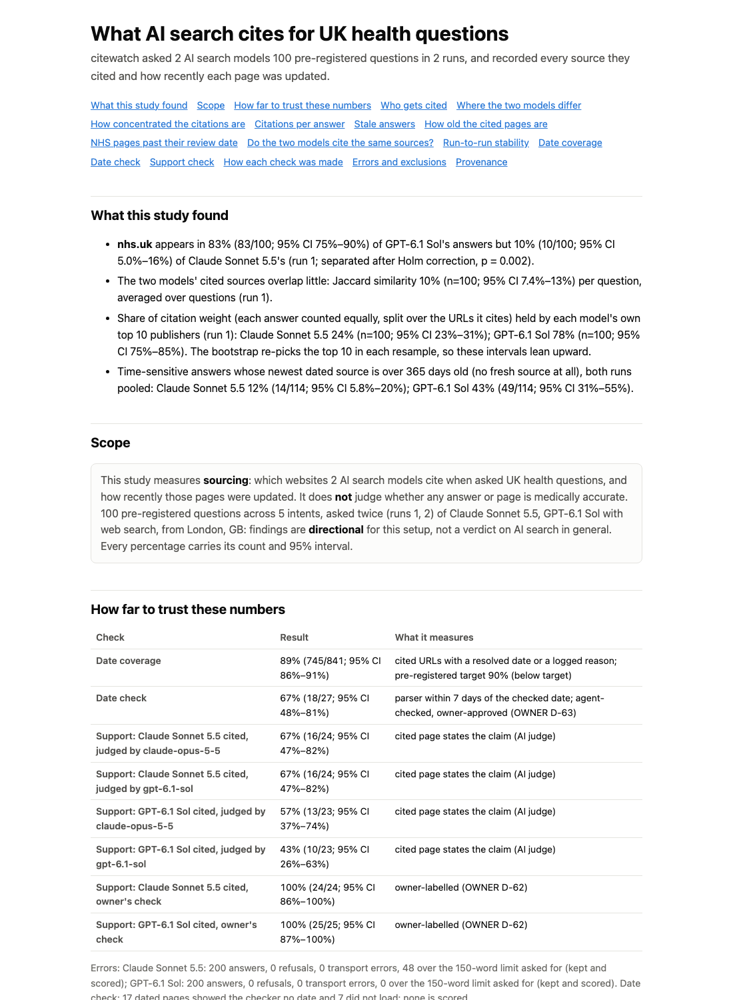
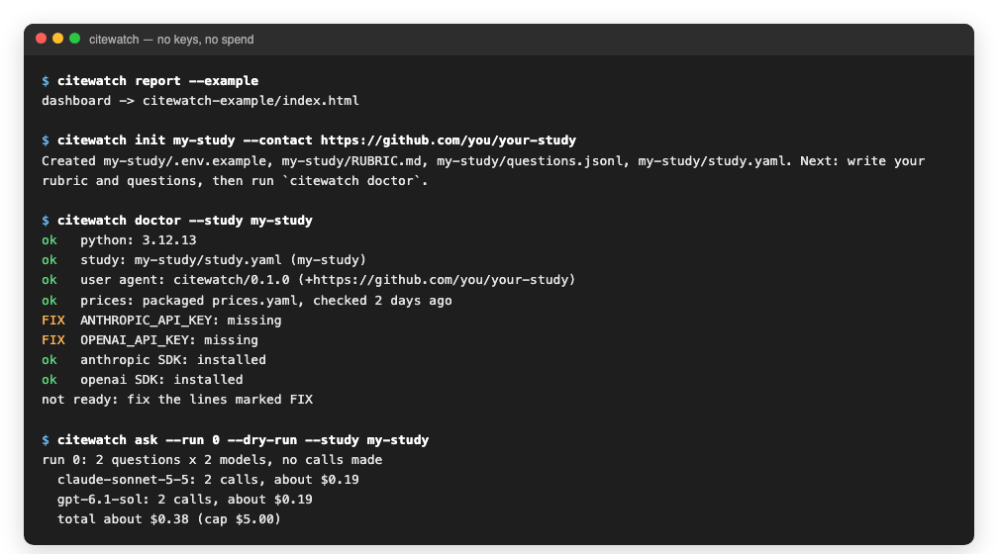
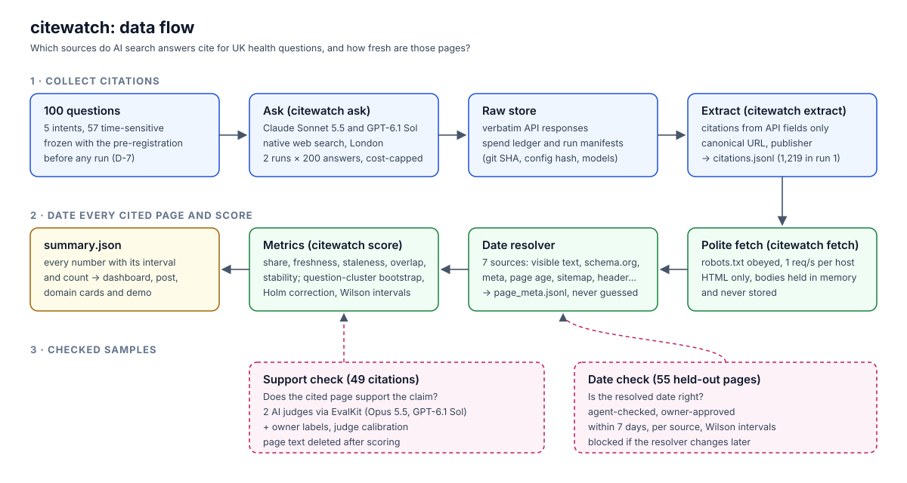

# citewatch

**Which websites do AI search answers cite, and how fresh are those pages?**

citewatch asks AI models questions with web search on, records every source they cite, visits
each cited page politely to find when it was last updated, and reports who gets cited, how
fresh it is and how far to trust each number, with counts and 95% intervals throughout. This
repository holds the tool and its first study: 100 pre-registered UK health questions asked of
Claude Sonnet 5.5 and GPT-6.1 Sol, twice.

**[Dashboard](https://biplob819.github.io/ai-visibility/)** ·
**[Post](https://biplob819.github.io/ai-visibility/post/)** ·
**[Signal spec (PDF)](docs/signal-spec.pdf)** ·
**[Data card](DATA_CARD.md)** ·
**[Pre-registration](docs/preregistration.md)** ·
**[Deviations](docs/deviations.md)** ·
**[Decisions](docs/decisions.md)**

It measures **sourcing, not medical accuracy**, and nothing here is medical advice.

## What the first study found

| | GPT-6.1 Sol | Claude Sonnet 5.5 |
|---|---|---|
| Answers citing nhs.uk (run 1) | 83% (83/100; 95% CI 75%–90%) | 10% (10/100; 95% CI 5.0%–16%) |
| Citation weight held by its top 10 publishers (run 1) | 78% (n=100; 95% CI 75%–85%) | 24% (n=100; 95% CI 23%–31%) |
| Time-sensitive answers whose newest dated source is over a year old (both runs) | 43% (49/114; 95% CI 31%–55%) | 12% (14/114; 95% CI 5.8%–20%) |

- The two models rarely cite the same publishers for the same question: Jaccard similarity
  10% (n=100; 95% CI 7.4%–13%) per question, run 1.
- The nhs.uk gap is separated in both runs after a Holm correction.
- How far to trust it: citewatch dated (or logged a reason for) 89% (745/841; 95% CI 86%–91%)
  of cited URLs, against a 90% target. On held-out pages it was within 7 days of the checked date on
  67% (18/27; 95% CI 48%–81%) (agent-checked, owner-approved). In the support check, the two AI
  judges and the owner disagree, so the support rate is reported, not settled.
- These findings are directional: one country, two models, 100 questions.

[](https://biplob819.github.io/ai-visibility/)

## Install

```bash
pip install citewatch                     # the core: report, score, dates, lookup
pip install 'citewatch[anthropic,openai]' # plus the provider SDKs for paid runs
uvx citewatch report --example            # or try it without installing
```

Python 3.11 or newer. See the [quickstart](docs/quickstart.md) (an example report in under
five minutes, no keys).

[](docs/quickstart.md)

## How it works



1. **Ask.** Each frozen question goes to each model with its native web search, from one
   location, under a cost cap; responses are stored verbatim (`citewatch ask`).
2. **Extract.** Citations come only from the APIs' citation fields, with canonical URLs and a
   publisher per URL (`citewatch extract`).
3. **Fetch and date.** Each cited page is fetched once, obeying robots.txt at one request per
   second per host; page bodies are held in memory and never stored. A date resolver reads
   seven sources (visible text, schema.org, meta tags, microdata and RDFa, the search tool's
   page age, sitemaps, HTTP headers) and never guesses (`citewatch fetch`).
4. **Score.** Shares, freshness, staleness, overlap and stability with a question-cluster
   bootstrap, Holm-corrected comparisons and Wilson intervals; domain cards for every cited
   publisher, each with an improvement report (`citewatch score`).
5. **Report.** The dashboard and post are built from `summary.json` (`citewatch report`).

Two checks sit under the numbers: a **support check** (do cited pages state the claim? two AI
judges via [EvalKit](https://github.com/biplob819/evalkit) and the owner's labels) and a
**held-out date check**. Architecture: [`docs/assets/architecture.svg`](https://raw.githubusercontent.com/biplob819/ai-visibility/main/docs/assets/architecture.svg).

## Rerun it

Look at the results with no keys and no spend:

```bash
git clone https://github.com/biplob819/ai-visibility && cd ai-visibility
uv sync
uv run citewatch report --example     # the bundled study's dashboard
```

Run your own study (paid calls need the provider SDKs and your API keys):

```bash
uv sync --extra anthropic --extra openai
uv run citewatch init my-study --contact <a page site owners can reach you at>
# edit my-study/study.yaml and my-study/questions.jsonl, and set the API keys in my-study/.env
uv run citewatch doctor --study my-study                  # names any missing key or SDK
uv run citewatch ask --run 0 --dry-run --study my-study   # cost estimate, no calls

# 1. A small paid smoke run measures what an answer really costs
uv run citewatch ask --run 0 --study my-study
uv run python scripts/measure_cost.py my-study --run 0    # writes my-study/cost_model.yaml

# 2. Before the study runs: freeze the questions and the metric definitions
#    write my-study/preregistration.md, record the sha256 of it and of questions.jsonl in a
#    decisions.md, and commit everything (a study run refuses a dirty or non-git folder)

# 3. The study runs, then the analysis
uv run citewatch ask --run 1 --study my-study             # run 2 waits at least two hours
uv run citewatch extract --study my-study
uv run citewatch fetch --study my-study
uv run citewatch score --study my-study
uv run citewatch report --study my-study --title "my topic"
```

`citewatch ask --run 1 --dry-run` lists anything the run gate still needs before it will spend.
The gate and why each check exists are in the Tech Spec (§3 and gates G1, G2).

**Cost.** The flagship study's smoke run cost $0.79 and its two study runs (400 answers) cost
$15.03 in API calls; the dry run estimates yours before any call, and `max_cost_usd` in
`study.yaml` caps it. Fetching costs nothing but time. Thresholds in `study.yaml` can fail a CI
job when a metric crosses a bound ([`docs/thresholds.md`](docs/thresholds.md)).

## Guides

| Guide | What it covers |
|---|---|
| [Quickstart](docs/quickstart.md) | the bundled study's dashboard in under five minutes, no keys |
| [Run your own study](docs/own-study.md) | settings, the questions format, intents, country, models, the run gate |
| [How dates are resolved](docs/dates.md) | the seven date sources, the rules and their limits |
| [Controlling cost](docs/cost.md) | estimates, the hard cap, resume, what the flagship study cost |
| [Thresholds in CI](docs/thresholds.md) | rules that fail a CI job when a metric crosses a bound |
| [Responsible use](docs/responsible-use.md) | politeness, no telemetry, privacy, not for gaming AI answers |
| [Versioning](docs/versioning.md) | semver and the public API |

## Responsible use

citewatch obeys robots.txt and a fixed politeness floor that no setting can loosen, sends
nothing anywhere except to the AI providers you configure and the cited sites, and is not a
tool for gaming AI answers ([`docs/responsible-use.md`](docs/responsible-use.md)).

## Repository map

| Path | What it holds |
|---|---|
| `src/citewatch/` | the package: runners, extract, fetch, dates, metrics, support, cards, report, demo |
| `studies/uk-health/` | the flagship study: questions, settings, frozen data, results |
| `docs/` | pre-registration, deviations, decisions, signal spec, data-flow and architecture diagrams |
| `demo/` | the Streamlit demo (lookup; live mode behind passkeys) |
| `specs/`, `docs/graph/` | the build plan: one spec per node and the capability catalog |

## Links

| | |
|---|---|
| Repository | https://github.com/biplob819/ai-visibility |
| Package | https://pypi.org/project/citewatch/ |
| Dashboard | https://biplob819.github.io/ai-visibility/ |
| Post | https://biplob819.github.io/ai-visibility/post/ |
| Signal spec | [docs/signal-spec.pdf](docs/signal-spec.pdf) |
| Data card | [DATA_CARD.md](DATA_CARD.md) |
| Pre-registration | [docs/preregistration.md](docs/preregistration.md) |
| Deviations | [docs/deviations.md](docs/deviations.md) |
| Decisions | [docs/decisions.md](docs/decisions.md) |
| Changelog | [changelog.md](changelog.md) |
| Support judging | [EvalKit](https://github.com/biplob819/evalkit) |

`scripts/check_links.py --online` checks every link in the README and docs.

## Licence

MIT ([`LICENSE`](LICENSE)). Contributions: [`CONTRIBUTING.md`](CONTRIBUTING.md); security
reports: [`SECURITY.md`](SECURITY.md).
